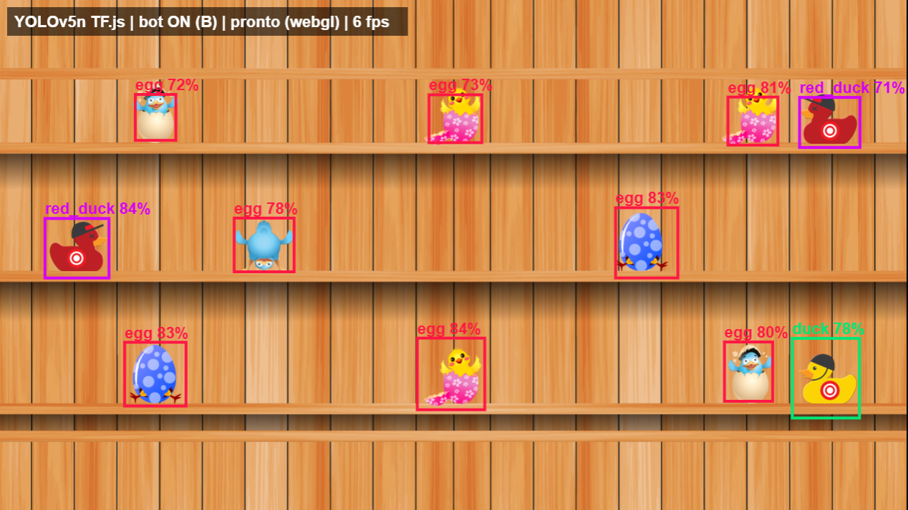
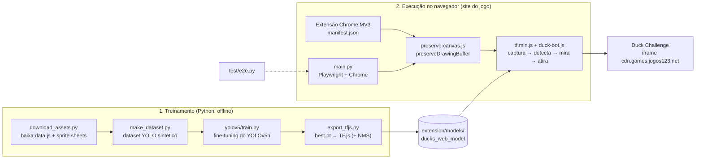
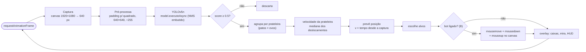
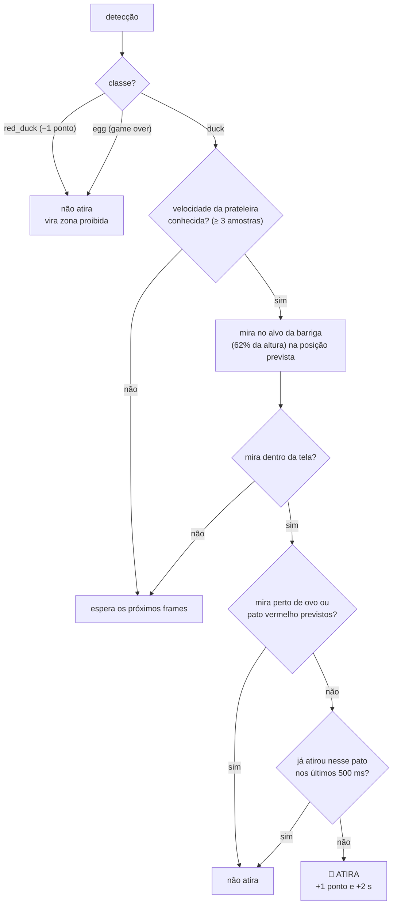

# 🦆 Acertando patos com YOLOv5 + TensorFlow.js

Uma IA que joga o [**Duck Challenge**](https://www.jogos123.net/jogo/duck-challenge) sozinha, direto no site
do jogo. Ela lê o canvas do jogo, roda um detector de objetos **YOLOv5n** no navegador com **TensorFlow.js**,
prevê para onde cada pato está andando e clica só nos patos certos.

> Exercício da pós-graduação — módulo **1 · Fundamentos de IA e LLMs para Programadores**.



📐 **Fluxograma completo no Figma (FigJam):** <https://www.figma.com/board/cEInNiFPuhem9StagY0hHW>
— visão geral, pipeline de treino, loop do bot, decisão de tiro e sequência da demo. Os mesmos fluxos
estão neste README em Mermaid, mais abaixo.

---

## Sumário

- [O jogo e o objetivo](#o-jogo-e-o-objetivo)
- [Início rápido](#início-rápido)
- [Arquitetura](#arquitetura)
- [Qual modelo e por quê](#qual-modelo-e-por-quê)
- [Como o bot funciona (frame a frame)](#como-o-bot-funciona-frame-a-frame)
- [Como o bot decide atirar](#como-o-bot-decide-atirar)
- [Treinamento do modelo](#treinamento-do-modelo)
- [Teste ponta a ponta](#teste-ponta-a-ponta)
- [Estrutura do projeto](#estrutura-do-projeto)
- [Configuração do bot](#configuração-do-bot)
- [Limitações conhecidas](#limitações-conhecidas)
- [Créditos e licenças](#créditos-e-licenças)

---

## O jogo e o objetivo

O Duck Challenge é um jogo de tiro ao alvo feito em **Construct 2** e desenhado num `<canvas>` WebGL. Patos
de borracha andam sobre três prateleiras, e entre eles aparecem ovos e pintinhos. Regras, lidas do `data.js`
do jogo:

| Ação | Efeito |
|---|---|
| Acertar pato **amarelo** com alvo | **+1 ponto** e **+2 s** no relógio |
| Acertar pato **vermelho** | **−1 ponto** |
| Acertar **ovo / pintinho** | o relógio vai a 0 → **game over imediato** |
| O relógio (começa em 9 s e perde 1 s por segundo) chega a 0 | game over |

Com 10/25/50/75/100/150 pontos os patos ficam mais rápidos e aparecem com mais frequência. Não há pontuação
máxima: o objetivo é **sobreviver o máximo possível**, acertando todos os amarelos e nunca um ovo.

Num teste no site real, a IA fez **43 pontos em menos de 1 minuto de partida, sem nenhum game over**,
rodando a ~5–9 fps.

---

## Início rápido

Requisitos: **Python 3.10+** e **Google Chrome** (ou Microsoft Edge) instalado.

```bash
git clone https://github.com/LucasAMLima/acertando-patos-tfjs.git
cd acertando-patos-tfjs
python -m venv .venv
.venv\Scripts\activate          # Linux/macOS: source .venv/bin/activate
pip install -r requirements.txt
```

### Opção 1 — Demo automática (`main.py`)

```bash
python main.py
```

Abre o Chrome **no site do jogo** (`https://www.jogos123.net/jogo/duck-challenge`), injeta a IA no iframe do
jogo e aperta **Play** sozinho, inclusive depois de cada game over. A demonstração roda em loop até você
fechar a janela. No terminal aparecem o placar, o tempo restante e as velocidades estimadas de cada
prateleira.

| Opção | O que faz |
|---|---|
| `--seconds 120` | joga por 120 s e fecha (padrão: até fechar a janela) |
| `--screenshots pasta/` | salva um screenshot a cada 2 s |
| `--no-autoplay` | não clica em Play: você inicia a partida e o bot só atira |

Dentro do jogo, a tecla **B** liga e desliga o bot. Se você não tiver Chrome nem Edge, rode
`python -m playwright install chromium` para usar o Chromium do Playwright.

### Opção 2 — Extensão do Chrome (no seu navegador do dia a dia)

1. Abra `chrome://extensions` e ative o **Modo do desenvolvedor**.
2. Clique em **Carregar sem compactação** e selecione a pasta `extension/`.
3. Abra <https://www.jogos123.net/jogo/duck-challenge> e clique em Play.

A extensão roda dentro do iframe do jogo (`cdn.games.jogos123.net`), em qualquer página que o incorpore.
O overlay mostra o que a IA vê:

| Cor | Classe | O bot… |
|---|---|---|
| 🟩 verde | `duck` (pato amarelo) | atira |
| 🟪 roxo | `red_duck` (pato vermelho) | evita |
| 🟥 vermelho | `egg` (ovo / pintinho) | evita a todo custo |
| 🟡 círculo amarelo | ponto de mira | — |

---

## Arquitetura



São duas partes independentes:

1. **Treinamento (offline, Python):** gera um dataset sintético a partir dos sprites do próprio jogo,
   re-treina o YOLOv5n e exporta para TensorFlow.js. O resultado já vem pronto em
   `extension/models/ducks_web_model/`, então **não é preciso treinar para usar**.
2. **Execução (navegador, JavaScript):** o mesmo código (`preserve-canvas.js` + `duck-bot.js`) roda de
   duas formas:
   - **pela extensão**, que o Chrome injeta no iframe do jogo;
   - **pelo `main.py`**, que abre o site com o Playwright e injeta os mesmos arquivos no iframe.

### A demo no site, passo a passo

```mermaid
sequenceDiagram
  participant U as Você
  participant PY as main.py (Playwright)
  participant BR as Chrome
  participant S as www.jogos123.net
  participant CDN as cdn.games.jogos123.net
  U->>PY: python main.py
  PY->>BR: abre o Chrome com init scripts (preserve-canvas + autoplay)
  BR->>S: GET /jogo/duck-challenge
  S-->>BR: página com o iframe do jogo
  BR->>CDN: carrega o jogo no iframe
  Note over BR: preserve-canvas.js roda ANTES do jogo criar o WebGL
  PY->>BR: injeta tf.min.js + duck-bot.js no iframe
  BR->>CDN: GET /__duck-bot/models/... (interceptado)
  PY-->>BR: model.json + pesos lidos de extension/
  BR->>BR: autoplay clica em Play; duck-bot joga em loop
  PY->>BR: a cada 2 s lê placar e estatísticas do bot
```

O modelo é entregue ao iframe interceptando requisições para
`https://cdn.games.jogos123.net/__duck-bot/...`. Como é a mesma origem do jogo, não há problema de CORS, e
nenhum arquivo do jogo é baixado nem servido localmente.

---

## Qual modelo e por quê

| Modelo | Resultado no jogo |
|---|---|
| `yolov5n` pré-treinado (COCO, 80 classes) | ❌ Não reconhece os patos de borracha desenhados: nunca diz `bird`; no máximo `frisbee` / `stop sign` com 4–29% de confiança. |
| **`yolov5n` fine-tuned** (3 classes: `duck`, `red_duck`, `egg`) | ✅ Detecta e diferencia os três tipos no jogo real. |

- O **YOLOv5n** ("nano") é o menor modelo da família YOLOv5: ~1,9 M de parâmetros e ~7 MB em TF.js. Isso dá
  inferência em tempo real no navegador, com backend WebGL.
- Ele foi **re-treinado por transfer learning** a partir dos pesos COCO, com um dataset sintético (veja
  [Treinamento](#treinamento-do-modelo)), e exportado com `export.py --include tfjs`.
- O export já embute o **NMS** (non-max suppression) no grafo. O modelo devolve direto
  `boxes`, `scores`, `classes` e `count`.
- O modelo COCO original fica em `training/baseline/` só para comparação.

---

## Como o bot funciona (frame a frame)



1. **Ver a tela:** o Construct 2 cria o contexto WebGL sem `preserveDrawingBuffer`. Assim o navegador limpa
   o buffer depois de cada frame, e ler os pixels daria uma imagem preta. O `preserve-canvas.js` roda antes do
   jogo (`document_start`, mundo `MAIN`) e substitui `HTMLCanvasElement.prototype.getContext` para forçar essa
   opção.
2. **Capturar barato:** o canvas de 1920×1080 é reduzido para 640 px de largura **na GPU** com `drawImage`, e
   só então é lido. São ~9× menos dados por frame.
3. **Pré-processar como o YOLOv5:** `tf.browser.fromPixels` → padding embaixo e à direita até ficar quadrado →
   640×640 → divide por 255.
4. **Detectar:** `model.executeAsync()` devolve as caixas já filtradas pelo NMS. O bot descarta detecções
   com confiança abaixo de 0,5.
5. **Rastrear por prateleira:** no jogo, todos os patos de uma prateleira andam juntos, a ±200 a ±500 px/s,
   com sentido alternado entre prateleiras. Os ovos ficam praticamente parados e só balançam. Por isso a
   velocidade é estimada **por (prateleira, grupo)**: mediana dos deslocamentos entre frames, suavizada
   (60% antiga + 40% nova). Isso é bem mais robusto do que rastrear cada objeto.
6. **Prever:** como a inferência leva dezenas de milissegundos, o mundo já andou quando o tiro sai. Cada objeto
   é projetado para `x + v × (agora − captura + 8 ms)`.
7. **Atirar:** dispara `mousemove`, `mousedown`, `mouseup` e `click` sintéticos no canvas, que o plugin Mouse do
   Construct escuta.
8. **Mostrar:** um canvas transparente por cima do jogo desenha as caixas (na posição prevista), os pontos de
   mira e um HUD com fps e status.

---

## Como o bot decide atirar



A **margem de segurança** em volta de ovos e patos vermelhos é de 35% da largura deles, mais um extra
proporcional à velocidade da prateleira. Errar um amarelo custa pouco; acertar um ovo encerra o jogo.

---

## Treinamento do modelo

> Opcional: o modelo treinado já está em `extension/models/ducks_web_model/`.

### O dataset sintético

Em vez de rotular imagens à mão, o `make_dataset.py` usa os **próprios sprites do jogo**:

```mermaid
flowchart LR
  CDN["CDN do jogo"] -->|"data.js + PNGs"| DL["download_assets.py"]
  DL --> MD["make_dataset.py"]
  MD --> S1["lê no data.js a posição<br/>de cada frame nas sprite sheets"]
  S1 --> S2["recorta: Duck_1..6 → duck / red_duck<br/>(cor média); Eggs → egg"]
  S2 --> S3["cola em posições e escalas<br/>aleatórias sobre as prateleiras"]
  S3 --> S4["distratores SEM rótulo: patos morrendo,<br/>buracos de bala, mira, explosão, textos"]
  S4 --> S5["augmentation: brilho, blur,<br/>qualidade JPEG, flip"]
  S5 --> DS[("1200 treino + 150 val<br/>ducks.yaml")]
```



- O `data.js` do Construct 2 lista a posição exata de cada frame de animação nas sprite sheets. Assim **cada
  bounding box é conhecida**, e os rótulos são perfeitos e de graça.
- Os 6 patos "vivos" (`Duck_1..6`) viram `duck` ou `red_duck` conforme a cor média dos pixels. Os 4 frames de
  `Eggs` viram `egg`.
- Os primeiros frames da animação de morte, quase iguais ao pato vivo, ficam fora. Os demais (pato girando)
  entram como **distratores sem rótulo**, junto com buracos de bala, mira, explosões e textos. Isso ensina o
  modelo a **não** detectar essas coisas.
- ~7% das imagens não têm nenhum objeto (exemplos negativos).

### Passo a passo (Windows)

```bash
cd training
git clone --depth 1 https://github.com/ultralytics/yolov5
python -m venv venv && venv\Scripts\activate
pip install torch torchvision --index-url https://download.pytorch.org/whl/cpu
pip install -r yolov5/requirements.txt tensorflow tf_keras jax tensorflow-hub
pip install --no-deps tensorflowjs==4.22.0
# tensorflowjs exige tensorflow_decision_forests, que não tem build para Windows;
# um módulo vazio basta (só é usado para modelos de decision forests):
mkdir venv\Lib\site-packages\tensorflow_decision_forests
type nul > venv\Lib\site-packages\tensorflow_decision_forests\__init__.py

python download_assets.py                                   # baixa data.js + sprites para training/assets/
python make_dataset.py --assets assets --out C:\datasets\ducks
cd yolov5
python train.py --img 640 --batch 16 --epochs 15 --data C:\datasets\ducks\ducks.yaml ^
                --weights yolov5n.pt --project C:\runs --name ducks --workers 0 --cache ram
cd ..
python export_tfjs.py --weights C:\runs\ducks\weights\best.pt   # copia para extension/models/
```

Dicas:
- Use um caminho **sem acentos** para o dataset e os runs.
- Use `--workers 0`: com vários workers, o PyTorch falhou ao carregar `shm.dll`.
- Em CPU, cada época leva ~6 min.
- O `export_tfjs.py` define `TF_USE_LEGACY_KERAS=1`, porque o export TF do YOLOv5 usa a API Keras 2, e coloca o
  `tensorflowjs_converter` do venv no `PATH`.

Os sprites baixados (`training/assets/`) e o clone do YOLOv5 (`training/yolov5/`) **não vão para o
repositório** (estão no `.gitignore`). São de terceiros e os comandos acima baixam de novo.

---

## Teste ponta a ponta

```bash
python test/e2e.py            # joga 90 s no site e salva screenshots em test/out/
python test/e2e.py 300        # 5 minutos
```

O teste usa o `main.py`, deixa a IA jogar no site real e confere quatro coisas:
- o modelo detectou patos amarelos;
- o bot atirou;
- o placar subiu;
- não houve game over.

Termina com código 0 se tudo passou. Ele **abre uma janela** do navegador, porque o site recusa navegadores
headless (HTTP 403).

---

## Estrutura do projeto

```
main.py                       # demo: abre o site do jogo e injeta a IA (Playwright)
requirements.txt              # dependências da demo (playwright)
extension/                    # extensão do Chrome (Manifest V3)
  manifest.json               # content scripts no iframe cdn.games.jogos123.net/html5/duck-challenge/*
  lib/tf.min.js               # TensorFlow.js 4.22 empacotado (MV3 não permite JS remoto)
  models/ducks_web_model/     # YOLOv5n treinado, formato TF.js graph model (+ NMS)
  src/preserve-canvas.js      # força preserveDrawingBuffer no WebGL do jogo
  src/duck-bot.js             # captura → inferência → rastreio → mira → clique + overlay
training/
  download_assets.py          # baixa data.js + sprite sheets do jogo (para treinar)
  make_dataset.py             # gera o dataset YOLO sintético com rótulos automáticos
  export_tfjs.py              # best.pt → TF.js → extension/models/
  baseline/yolov5n_web_model/ # YOLOv5n COCO original em TF.js (só para comparação)
test/e2e.py                   # teste ponta a ponta no site real
docs/demo.png                 # screenshot usado neste README
```

---

## Configuração do bot

Os parâmetros ficam no objeto `CONFIG`, no início de [`extension/src/duck-bot.js`](extension/src/duck-bot.js):

| Parâmetro | Padrão | Para que serve |
|---|---|---|
| `minScore` | `0.5` | confiança mínima para considerar uma detecção |
| `targetClass` | `0` (`duck`) | a única classe em que o bot atira |
| `avoidClasses` | `[1, 2]` | `red_duck` e `egg`: nunca atirar perto |
| `safetyMargin` | `0.35` | margem extra em volta dos proibidos (fração da largura deles) |
| `laneTolerance` | `0.06` | objetos com a base nessa faixa de altura (fração da tela) estão na mesma prateleira |
| `shotMemoryMs` | `500` | não atira de novo no mesmo pato enquanto ele "morre" |
| `clickDelayMs` | `8` | atraso estimado entre decidir e o jogo processar o clique |

O `duck-bot.js` publica as estatísticas em `<html data-duck-bot="{...}">` no iframe do jogo, a cada ~15
frames: frames, tiros, detecções por classe, velocidades das prateleiras, fps e status. É assim que o
`main.py` e o teste leem o que o bot está fazendo, já que content scripts rodam num mundo isolado.

---

## Limitações conhecidas

- **Navegador headless é bloqueado pelo site** (HTTP 403). A demo e o teste sempre abrem uma janela.
- **O Chrome e o Edge atuais ignoram `--load-extension`**, então o `main.py` não carrega a extensão: ele injeta
  os mesmos arquivos no iframe com o Playwright. Para usar a extensão de verdade, instale-a pelo
  `chrome://extensions`.
- **Desempenho:** ~5–9 fps com GPU. Nas fases mais rápidas, a precisão cai, porque a previsão de posição fica
  mais longa.
- **O modelo só conhece este jogo:** foi treinado só com os sprites do Duck Challenge.
- Se o site mudar o endereço do iframe (`cdn.games.jogos123.net/html5/duck-challenge/`), é preciso atualizar o
  `manifest.json` e as constantes no topo do `main.py`.

---

## Créditos e licenças

- **Duck Challenge** pertence aos seus autores e é hospedado pelo jogos123 / Play123. Este repositório não
  inclui nenhum arquivo do jogo; o bot roda sobre o jogo no site oficial.
- **[YOLOv5](https://github.com/ultralytics/yolov5)** © Ultralytics, licença **AGPL-3.0**. O modelo em
  `extension/models/` é um fine-tuning do YOLOv5n e o de `training/baseline/` é o YOLOv5n original, ambos
  derivados desse trabalho.
- **[TensorFlow.js](https://github.com/tensorflow/tfjs)** © Google, licença **Apache-2.0** (empacotado em
  `extension/lib/tf.min.js`).
- **[Playwright](https://playwright.dev/python/)** © Microsoft, licença **Apache-2.0**.

Projeto educacional, feito para estudar visão computacional, transfer learning e inferência no navegador.
